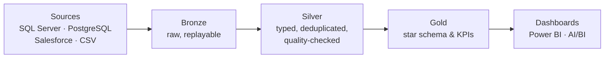

<h1 align="center">Hi 👋, I'm Sujay</h1>
<h3 align="center">I build data pipelines, then check whether the numbers are actually right.</h3>

  
  
  

Data analyst and data engineer · Master of Data Science (Professional), Deakin University.

- 🟢 **Open to** data analyst and data engineer roles in Australia
- 🔭 Currently building a **healthcare data project**
- 🏗️ Building **[LedgerLake](https://github.com/sujay181/ledgerlake)** in public: a metadata-driven Databricks lakehouse, one layer a day
- 💬 Ask me about **medallion architecture, marketing attribution, DAX and Power BI, or why last-touch attribution lies**
- 📄 Published: *Livenessnet with Hardware Interface for higher Security*, IJARCCE 2023 ([DOI](https://doi.org/10.17148/IJARCCE.2023.125118))
- 📫 Reach me at `sujaynarayana.181@gmail.com`

### How I build

### Findings from my projects

| Finding | Project |
|---|---|
| **23%** of a $2M marketing budget misallocated by last-touch attribution | [mkt-intel](https://github.com/sujay181/mkt-intel) |
| **−77%** profit margin on orders discounted above 40% | [superstore-sales-eda](https://github.com/sujay181/superstore-sales-eda) |
| **≈0** measurable effect of heatwaves on daily road accidents in Victoria (p = 0.77) | [Victoria accidents](https://github.com/sujay181/Victoria-road-accidents-weather-analysis) |

### Tools

### Featured projects

| Project | What it shows |
|---|---|
| [**Marketing attribution platform**](https://github.com/sujay181/mkt-intel) | Scores six attribution models against known ground truth. Python, DuckDB, dbt, Spark |
| [**RetailQ lakehouse**](https://github.com/sujay181/retailq-databricks-lakehouse) | PostgreSQL, Salesforce and CSV into a Databricks medallion pipeline, star schema, metric view, AI/BI dashboard and Genie |
| [**Student Central dashboard**](https://github.com/sujay181/student-central-powerbi-dashboard) | Power BI dashboard on complaints, club engagement and alumni reach, built on a 455-record synthetic dataset I designed |
| [**LedgerLake**](https://github.com/sujay181/ledgerlake) | Metadata-driven Databricks lakehouse for a fictional neobank, with tests and CI (in progress) |
| [**Superstore sales EDA**](https://github.com/sujay181/superstore-sales-eda) | Finds where discounts and product mix erase profit |
| [**Victoria road accidents & weather**](https://github.com/sujay181/Victoria-road-accidents-weather-analysis) | Count models (Negative Binomial, GAM) in R |
